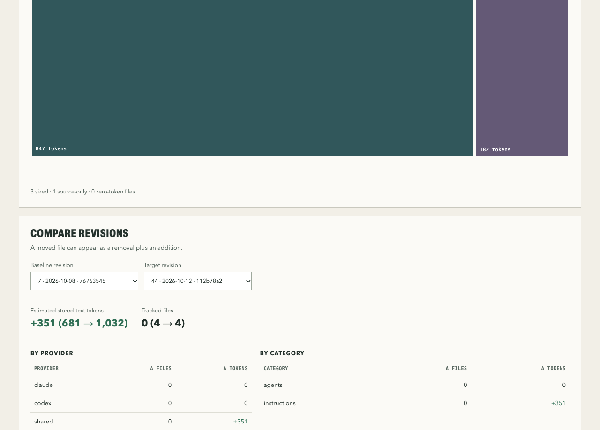
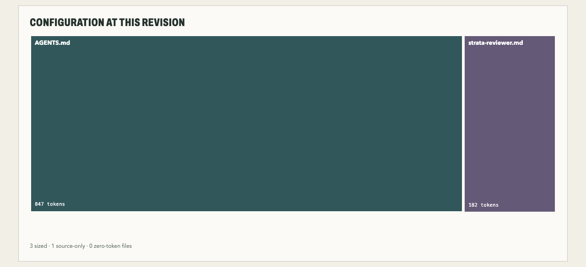
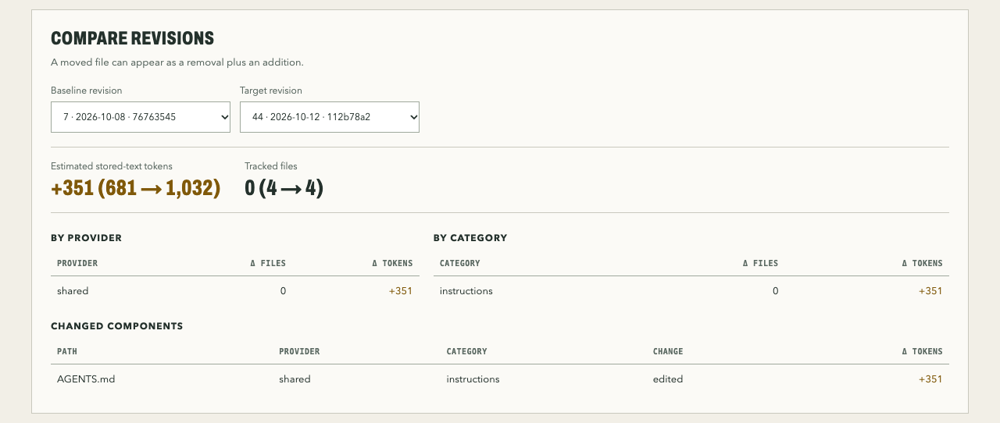

<h1 align="center">
  <picture>
    <source media="(prefers-color-scheme: dark)" srcset="docs/brand/logo-wordmark-dark.svg">
    
  </picture>
</h1>

<p align="center">
  <a href="https://www.npmjs.com/package/context-strata"></a>
  
  
  <a href="https://github.com/nabondance/strata/actions/workflows/ci.yml"></a>
  <a href="https://www.npmjs.com/package/context-strata"></a>
  <a href="https://github.com/nabondance/strata/stargazers"></a>
  
  <a href="#readme-image-and-badge"></a>
</p>

**See how your agent context evolved across Git history.**

<p align="center">
  <picture><source media="(prefers-color-scheme: dark)" srcset="docs/brand/providers/claude-dark.svg"></picture>&nbsp;Claude Code&nbsp;&nbsp;&nbsp;
  <picture><source media="(prefers-color-scheme: dark)" srcset="docs/brand/providers/codex-dark.svg"></picture>&nbsp;Codex&nbsp;&nbsp;&nbsp;
  <picture><source media="(prefers-color-scheme: dark)" srcset="docs/brand/providers/gemini-cli-dark.svg"></picture>&nbsp;Gemini CLI&nbsp;&nbsp;&nbsp;
  <picture><source media="(prefers-color-scheme: dark)" srcset="docs/brand/providers/github-copilot-dark.svg"></picture>&nbsp;GitHub Copilot&nbsp;&nbsp;&nbsp;
  <picture><source media="(prefers-color-scheme: dark)" srcset="docs/brand/providers/cursor-dark.svg"></picture>&nbsp;Cursor
</p>

Your `CLAUDE.md`, `AGENTS.md`, skills, rules, and agent definitions started small. Then every incident, convention, and "always remember to…" got appended. Strata replays your Git history and shows what that configuration weighs today, when it grew, and which files drove it.

Requires Node.js 22.13 or newer and Git 2.31 or newer.

```sh
npx context-strata analyze --open
```

One command, run inside any Git repository. You get a single offline HTML report. Nothing is uploaded and the repository is never modified. The command ends with a summary like this:

```text
Analyzed 46 revisions of strata.
Latest: 4 tracked components, 1151 stored-text tokens (utf8-bytes-divided-by-four-v1: UTF-8 bytes / 4, rounded up per instructional file).
Report: /tmp/strata-report-k3Xb9Q/report.html
```



The images on this page are Strata's report on its own repository.

## How it works

Strata walks the first-parent history of your branch, oldest to newest, and reads the tracked Git blobs at each commit; it never looks at the working tree. Files that match a known agent-configuration path are measured: instruction files by an estimate of their stored-text tokens, structured settings and bundled resources by source bytes. The default estimate is UTF-8 bytes divided by four, which is fast, offline, and consistent across a whole history; an opt-in flag counts with an exact OpenAI encoding instead. Every measurement describes what the repository **stores**, not what an agent loaded in a session or what you were billed.

## What you get

- **A timeline** of stored instruction tokens across your branch's history, split by category.
- **A treemap** of any revision, so the file eating most of the budget is the biggest rectangle.
- **A configuration map** of any revision: every file in its folder with its share of the tokens, and a line for each Claude `@path` import between two files.
- **A comparison** between any two revisions, with signed token and file-count changes per provider, category, and file.
- **Per-provider views** for Claude Code, Codex, Gemini CLI, Cursor, and GitHub Copilot, with shared files such as `AGENTS.md` counted once in the overall total.
- **A pull-request delta**, as Markdown or JSON, to see what a change adds before it merges.
- **An SVG image** of the history to embed in your own README, in full or as the layers alone (`--minimal`), and a **badge** with the latest total.
- **JSON output** for your own scripts, plus a bundled `strata-interpret` skill that teaches a coding agent how to read it, the HTML report, and `strata diff` output.

The treemap sizes each file by its stored-text tokens at the selected revision:



Pick any two revisions to see what changed between them:



From the command line, `strata diff` prints a summary like this one:

```text
Stored instructional text: +330 tokens (681 → 1011); tracked files: 0 (4 → 4).

| File      | Change | Δ tokens |
| --------- | ------ | -------: |
| AGENTS.md | edited |     +330 |
```

And `strata analyze --format svg` draws the history as a static image for a README. This one is rendered from `main` by [this repository's own workflow](.github/workflows/strata-image.yml) on every push:


## Is it for you?

Strata is useful if you maintain agent configuration in a repository and want to answer questions like:

- When did our instructions double, and which commit did it?
- Did moving guidance from the root file into skills actually shrink it?
- How much does this pull request add?
- Which skills carry the most text and bundled resources?

It is honest about what it cannot tell you. Strata measures the text **stored in Git**. It counts every tracked instruction file, including skills and nested instructions that an agent only loads on demand, so totals describe what the repository holds, not what a session loaded or what you were billed.

## Private by default

- **Read-only.** Strata reads tracked Git blobs. It never touches your working tree, index, or history.
- **Offline.** No network access, unless you explicitly opt in to precise provider token counts with `--precise`, which uses your signed-in [`ant`](https://github.com/anthropics/anthropic-cli) or `gcloud` account or an API key, and says what it sent where ([setup](docs/usage.md#precise-counts)).
- **No file contents in reports.** HTML and JSON hold paths, commit IDs, dates, and measurements, never the text of your instructions.
- **Shareable mode.** `--shareable` replaces repository and branch names, paths, and commit IDs with stable aliases before you send a report to someone else.

## Usage

Pick the way that fits how you want to use it:

| You want to… | Use | Setup |
| --- | --- | --- |
| Look at one repository right now | `npx context-strata analyze --open` | None |
| Run it regularly from your terminal | `npm install --global context-strata`, then `strata` | One install |
| See what each pull request adds | The [GitHub Action](#in-pull-requests) | One workflow file |
| Keep a history image in your README | The [image workflow](docs/ci.md#readme-image) | One workflow file |
| Let a coding agent read the numbers | `--format json` and the [bundled skill](#with-a-coding-agent) | None |

Not sure? Take the first one.

```sh
# Analyze the current repository and open the report
npx context-strata analyze --open

# Analyze another repository and choose where the report goes
npx context-strata analyze ~/src/project --output report.html

# Machine-readable output
npx context-strata analyze --format json --output report.json

# A picture of the history for your README, and a shields.io badge with the latest total
npx context-strata analyze --format svg --output docs/strata.svg
npx context-strata analyze --format badge --output strata-badge.json

# What changed between two commits
npx context-strata diff --base <base-commit> --head <head-commit>

# The same, exiting with status 3 if instructions grew by more than 500 tokens
# or Claude Code keeps more than 8,000 tokens at session start
npx context-strata diff --base <base-commit> --head <head-commit> --limit-increase 500 --limit-up-front-tokens claude=8000
```

Install it globally with `npm install --global context-strata` to get the `strata` command. Run `strata --help` or `strata <command> --help` for every option. [Limits](docs/usage.md#limits) are off unless you set them, and growth alone never fails a run.

To try changes before they are released, install the [canary build](https://github.com/nabondance/strata/releases/tag/canary) of the latest `main` with `npm install --global https://github.com/nabondance/strata/releases/download/canary/context-strata.tgz`, and run it again to update. It passes the same checks as a release, but its report format can change before the next version.

### Token counts

By default Strata estimates tokens as UTF-8 bytes divided by four. For offline OpenAI encoding counts, pass `--model gpt-4o` or `--tokenizer openai-o200k_base`. Every report names the method it used. See [the tokenizer study](docs/tokenizers.md) for the evidence and limits.

### In pull requests

An opt-in [GitHub Action](docs/pr-action.md) writes the configuration delta of a pull request to the job summary. It is one step after `actions/checkout`: it finds the pull request's commits itself and fetches those the checkout lacks. It needs only `contents: read` and posts no comments. Optional [limits](docs/pr-action.md#limits), such as `limit-up-front-tokens: claude=8000`, fail or warn when a figure passes a number you choose, and its [outputs](docs/pr-action.md#outputs) give later steps the totals.

<!-- x-release-please-start-version -->
```yaml
name: Agent context delta
on: pull_request
permissions:
  contents: read
jobs:
  strata:
    runs-on: ubuntu-latest
    steps:
      - uses: actions/checkout@v7
      - uses: nabondance/strata@v0.5.0
        with:
          limit-up-front-tokens: 8000 # optional
```
<!-- x-release-please-end -->

### README image and badge

This repository runs the same workflow on its own pull requests ([strata-pr-delta.yml](.github/workflows/strata-pr-delta.yml)) and renders the image above and the `agent context` badge at the top of this page on every push to `main` ([strata-image.yml](.github/workflows/strata-image.yml)). [Running Strata in CI](docs/ci.md) covers publishing the full report or keeping a README image current.

### With a coding agent

Write a JSON report, then give your agent the bundled skill so it reads the schema correctly instead of guessing:

```sh
npx context-strata analyze --format json --output strata.json
npx context-strata skill --output .claude/skills/strata-interpret/SKILL.md   # or .agents/skills/… for Codex, Copilot, Cursor, and Gemini CLI
```

The skill explains the revision and component tables, what the token estimates do and do not mean, and which conclusions the JSON cannot support.

## What Strata recognizes

Configuration tracked in the repository, at the root or in nested project directories. Instruction files get a token estimate; structured configuration and bundled resources are measured in bytes rather than given an invented token count. Files that Claude instruction files import with `@path` are resolved at each revision and included too, and imports that do not resolve are listed.

| | Claude Code | Codex | Gemini CLI | Cursor | GitHub Copilot |
| --- | --- | --- | --- | --- | --- |
| Instructions | `CLAUDE.md`, `CLAUDE.local.md`, `.claude/CLAUDE.md`, `REVIEW.md`, `AGENTS.md` (shared) | `AGENTS.md` (shared), `AGENTS.override.md` | `GEMINI.md`, `.gemini/system.md`, `AGENTS.md` (shared), as `context.fileName` selects | `AGENTS.md` (shared)\* | `.github/copilot-instructions.md`; `AGENTS.md`, `CLAUDE.md`, `REVIEW.md`, `GEMINI.md`\* |
| Skills | `.claude/skills/*/SKILL.md` + resources | `.agents/skills/*/SKILL.md` (shared) + resources | `.gemini/skills/*/SKILL.md`, `.agents/skills/*/SKILL.md` (shared) + resources | `.cursor/skills/*/SKILL.md` + resources; `.agents/skills` and `.claude/skills`\* | `.github/skills/*/SKILL.md` + resources; `.agents/skills` and `.claude/skills`\* |
| Agents | `.claude/agents/**/*.md` | `.codex/agents/*.toml` | `.gemini/agents/*.md` | | `.github/agents/**/*.md`, `.chatmode.md` (legacy); `.claude/agents`\* |
| Rules | `.claude/rules/**/*.md` | `.codex/rules/**/*.rules` | | `.cursor/rules/**/*.mdc`, `.cursorrules` (legacy) | `.github/instructions/**/*.instructions.md`; `.claude/rules`\* |
| Commands | `.claude/commands/**/*.md` | | `.gemini/commands/**/*.toml` | `.cursor/commands/*.md` | `.github/prompts/*.prompt.md` |
| Settings and tools | `.claude/settings*.json`, `.mcp.json` | `.codex/config.toml` | `.gemini/settings.json` | `.cursor/mcp.json`, `.cursorignore` | `.github/mcp.json`, `.vscode/mcp.json`, `.github/hooks/*.json`, `.github/copilot/settings.json`, `copilot-setup-steps.yml`, `copilot-code-review.yml`; `.mcp.json`\* |

\* Cursor and Copilot read these other tools' files too, but Strata counts them in each tool's view only at revisions that track that tool's configuration. A repository without Cursor or Copilot files is reported without them.

[The analysis scope](docs/analysis-scope.md) lists every pattern, its measurement, and the provider documentation it follows. Provider additions are welcome as pull requests; the [Cursor](docs/next-adapter.md) and [Copilot](docs/copilot-adapter.md) adapter studies show the evidence one needs.

## Questions

**Does it read my working tree or uncommitted files?** No. Strata reads blobs from Git history through read-only commands. Untracked, ignored, and uncommitted files are invisible to it.

**How accurate is "bytes divided by four"?** It is a comparison estimate, good enough to see growth and find the heaviest files, and it stays consistent across revisions. For exact counts under an OpenAI encoding, use `--model` or `--tokenizer`; for Claude and Gemini, `--precise` asks each provider's count endpoint ([setup](docs/usage.md#precise-counts)). [The tokenizer study](docs/tokenizers.md) shows how the methods differ. No mode measures billing tokens.

**Does the total equal what my agent loads into context?** No. Strata counts everything tracked, including skills and nested instructions that load only on demand. The total is an upper bound on stored instructions, not a measurement of a session. For skills, the report also shows the smaller part an agent keeps in context before a skill is used: its frontmatter name and description. For each agent, it separates what is listed up front at the start of a session at the repository root (root instructions, rules that load at launch, Claude imports, and skill names and descriptions) from what it reads on demand.

**Can I share a report from a private repository?** Reports never contain file contents. Add `--shareable` to also replace repository and branch names, paths, and commit IDs with aliases, then inspect the report before sending it.

## Learn more

- [Using Strata](docs/usage.md): CLI output options, reading the report, and the JSON format.
- [Pull-request delta](docs/pr-action.md): the GitHub Action and the `strata diff` command.
- [Running Strata in CI](docs/ci.md): reports, README images, and pull-request deltas from a workflow.
- [Token counting](docs/tokenizers.md): the estimate, the OpenAI encodings, and their limits.
- [Analysis scope](docs/analysis-scope.md): recognized paths and exclusions.
- [Decisions](docs/decisions.md): measurement and report contracts.
- [Benchmark notes](docs/benchmark.md): performance on large histories.
- [Changelog](CHANGELOG.md)

## Contributing

Issues and pull requests are welcome. [CONTRIBUTING.md](CONTRIBUTING.md) covers the development setup and checks, [CODE_OF_CONDUCT.md](CODE_OF_CONDUCT.md) the community expectations, and [SECURITY.md](SECURITY.md) how to report a vulnerability.

Strata is released under the [MIT license](LICENSE).
