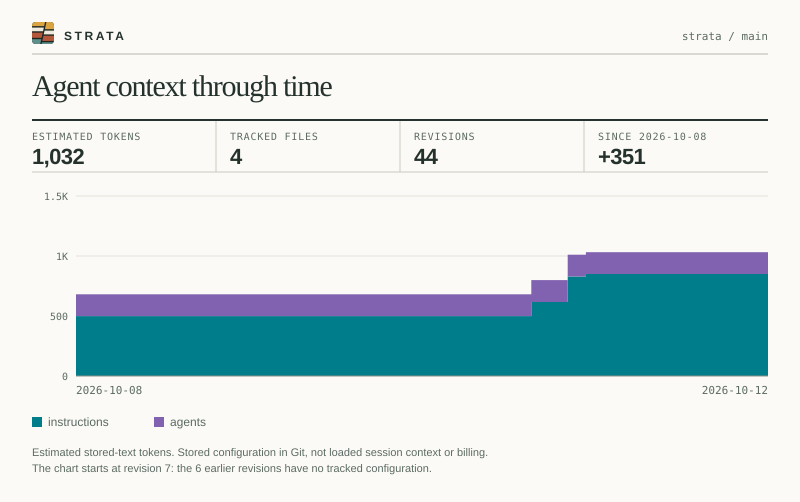

# Using Strata

This page covers the CLI's output options, how to read the HTML report, and the shape of the JSON. For the short version, see the [README](../README.md).

Strata reads tracked Git blobs from a repository's first-parent history and creates a local report of how recognized agent configuration changed over time. It does not inspect the repository's working tree or send its contents anywhere. Instructional text gets a labeled stored-text token measurement; structured configuration and supporting resources are measured in source bytes. These measurements do not show what an agent loaded in a session. Reports include paths and measurements, never file contents.

## Analyze a repository

```sh
strata analyze /path/to/git/repository
```

The repository argument defaults to the current directory. By default, Strata writes the report to a private temporary directory and prints its path. Use `--open` to open an HTML report or SVG image with the default application or `--output report.html` (`-o`) to choose a destination. For machine-readable output, use `--format json` (`-f json`), and `--output -` to write the report to standard output for another program. Progress and the summary go to stderr in that case; `--quiet` silences both and prints only the report path.

```sh
strata analyze /path/to/repository --open
strata analyze /path/to/repository --format json --output report.json
strata analyze --format json --output - | jq '.revisions[] | [.date, .estimatedTokens]'
```

For a picture of the history to put in a README, use `--format svg`. The image shows stored-text tokens per category through time, with the latest totals. It contains the repository and branch names, dates, and totals, but no paths, commit IDs, or file contents; `--shareable` also replaces the repository and branch names.

```sh
strata analyze /path/to/repository --format svg --output docs/strata.svg
```



Add `--minimal` to draw only the layers, edge to edge on a transparent background, with no text, axes, or legend. That image carries no repository or branch name and no dates.

```sh
strata analyze /path/to/repository --format svg --minimal --output docs/strata-minimal.svg
```


Both images are Strata's own repository.

Then reference it from the README as ``. To keep it current without committing it by hand, see [Running Strata in CI](ci.md#readme-image).

For a badge instead of a chart, `--format badge` writes the latest total as [shields.io endpoint JSON](https://shields.io/badges/endpoint-badge): `agent context | ≈1,151 tokens`, where `≈` marks an estimate and disappears under an encoding-exact tokenizer. It names nothing from the repository. Publish the file somewhere public and point shields at it:

```sh
strata analyze /path/to/repository --format badge --output strata-badge.json
```

```markdown

```

Shields' `label`, `color`, and `style` query parameters restyle it. [Running Strata in CI](ci.md#readme-image) publishes the badge next to the image.

Strata exits with status 0 on success, 2 when the command line is invalid, and 1 for any other failure, such as a path that is not a Git repository.

## Compare two commits

Compare two full commit IDs with `diff`. It reads both revisions directly from Git and prints a Markdown summary by default; choose `--format json` for structured data or `--output` to save the result.

```sh
strata diff /path/to/repository --base <base-commit> --head <head-commit>
strata diff /path/to/repository --base <base-commit> --head <head-commit> --format json --output delta.json
```

For pull requests, the opt-in [composite Action](pr-action.md) runs the same comparison and writes the delta to the job summary. It reads Git blobs without checking out either revision or posting a comment. To publish the full history report or a README image from CI, see [Running Strata in CI](ci.md).

## Token measurement

The default `--tokenizer estimate` divides instructional text's UTF-8 byte length by four. For offline OpenAI text-encoding counts, use `--tokenizer openai-cl100k_base` or `--tokenizer openai-o200k_base`, or select a supported model with `--model gpt-4o` (also `gpt-4`, `gpt-4.1`, `gpt-5`, `o3`, or `o4-mini`). Use either `--model` or `--tokenizer`, not both. The chosen method applies consistently across the history and measures stored text, not loaded context, message framing, or billing. See [the tokenizer study](tokenizers.md) for details and limits.

### Precise counts

`strata analyze --precise` counts each provider's instructions with the most precise method it can find, with no other flag:

1. **A signed-in account.** For Claude, an `ant auth login` profile from the Anthropic CLI, or, without one, a ready `gcloud` account on Vertex AI with Claude enabled. For Gemini, a `gcloud` account with a project set (`gcloud config set project`, or `GOOGLE_CLOUD_PROJECT`), counted through Vertex AI in `GOOGLE_CLOUD_LOCATION` (default `global`). See [signing in](#signing-in-for-precise-counts) below.
2. **An API key** in the environment: `ANTHROPIC_API_KEY`; `GEMINI_API_KEY` or `GOOGLE_API_KEY`.
3. **A local exact tokenizer.** Codex instructions always use the OpenAI encoding of `--codex-model` (default `gpt-5`) and are never sent. Claude and Gemini have none.
4. **The byte estimate.**

Only providers with recognized instructions somewhere in the history are counted: a repository with only Claude files never runs `gcloud` or asks for a Gemini key, and one with only Gemini files never runs `ant`. The defaults are `claude-opus-5-5` and `gemini-3.8-flash`; override them with `--claude-model` and `--gemini-model`. **What leaves the machine:** when step 1 or 2 applies, Strata sends the text of each recognized Claude or Gemini instruction file version to that provider's token-count endpoint. Before it does, it prints the host and the number of file versions; the run ends with each provider's method and anything it skipped. Settings, skill resources, and Codex files are never sent. Without `--precise`, nothing is sent. Reports record the method, its accuracy, the credential source, and the receiving host, never a key or token. The older `--provider-api` flag still works but is deprecated.

- **Message wrapper.** A count endpoint counts a whole request, so each file's count includes a few tokens for wrapping it in a message: about 8 for Claude. Strata counts a one-letter message once per model, takes its count less one as the wrapper, and subtracts that from every file, so counts describe the stored text and add up across files. The report records it as `wrapperTokens`.
- **Rate limits.** A rate-limited, overloaded, or failed request is retried up to six times with backoff, waiting as long as the endpoint's `retry-after` asks. Only a method that still fails falls back to the next one.
- **Cache.** Remote counts are kept per endpoint, model, and Git blob in `provider-counts.json` under `STRATA_CACHE_DIR`, or the user cache directory (`~/Library/Caches/strata` on macOS, `$XDG_CACHE_HOME/strata` or `~/.cache/strata` on Linux, `%LOCALAPPDATA%\strata` on Windows). A later run sends only file versions it has not counted before and says how many came from the cache. The file holds blob IDs, model names, and counts, never paths or text, and is readable by the owner only. `--no-cache` neither reads nor writes it; delete the file to clear it.
- **Dry run.** `strata analyze --precise --dry-run` prints, for each provider, the method it would use, how many file versions it would send and where, and what it would skip, then stops without sending anything or writing a report.
- **In the HTML report.** A provider tab opens on that provider's own counts when it has them, with a switch back to the byte estimate. The chart, totals, treemap, and comparison follow the selected count, and the "how this is measured" note describes the method actually used, including where text was counted, the credential source, the wrapper, and any fallback.
- **Pull requests.** `strata diff --precise` adds each provider's totals at the base and head commits, and the [GitHub Action](pr-action.md) takes `precise: 'true'`.

#### Signing in for precise counts

Strata does not install or sign in to provider CLIs. It asks an installed CLI for a short-lived access token and never reads credential files. If a CLI is missing, `--precise` falls back to the next method and the run says so, with the install command:

```text
Claude: 1231 tokens latest, byte estimate.
  Skipped: the Anthropic CLI (`ant`) is not installed; to count with your Anthropic account, install it with `brew install anthropics/tap/ant` (or see https://github.com/anthropics/anthropic-cli) and run `ant auth login`.
```

**Claude.** [`ant`](https://github.com/anthropics/anthropic-cli) is Anthropic's command-line tool for the Claude API, separate from Claude Code. Install and sign in once:

```sh
brew install anthropics/tap/ant      # macOS; Linux builds are on the releases page
ant auth login                       # opens a browser
ant auth status                      # shows the active profile
```

`ant auth login` signs in to a Claude Platform (API Console) organization and workspace, not to a Claude.ai Pro or Max subscription, so an account there is needed. A Claude Code login is not used: Anthropic does not permit other tools to use it.

**Gemini, and Claude through Google Cloud.** Install the [Google Cloud CLI](https://cloud.google.com/sdk/docs/install), then run `gcloud auth login` and `gcloud config set project <project>` for a project with the Vertex AI API enabled. Claude is counted this way only when no `ant` account is signed in, and only if the project has Claude enabled in Model Garden; someone who only uses Claude and has no ready `gcloud` is never asked about it. A Gemini CLI login is not used: its terms forbid third-party tools from using it.

## Shareable reports

For HTML or JSON analysis output, `--shareable` replaces repository and branch names, file paths, skill directory names, commit IDs, and blob IDs with deterministic aliases. Dates, labels, and measurements remain visible, so inspect a report before sharing it.

## The interpretation skill

To print the bundled JSON interpretation skill for a coding agent, or save it at a chosen path:

```sh
strata skill
strata skill --output .agents/skills/strata-interpret/SKILL.md
```

The `skill` command refuses to overwrite an existing file.

## Reading the HTML report

The comparison starts against the previous revision, so it lists what the selected revision changed. Select any baseline and target revision to compare signed estimated-token and file-count changes by provider, category, and component. The timeline controls the target revision. For histories longer than 100 revisions, the chart groups adjacent revisions into at most 100 bars; each bar shows its group's last revision, while the slider still reaches every charted commit. The chart and slider start at the first revision with tracked configuration in the current view; earlier revisions stay available in the baseline and target selectors. Comparison is based on stored files at those two points; a moved file may appear as a removal and an addition.

The report opens on **All files**, counting each tracked file once. Provider tabs show a provider's files together with the shared files it reads (`AGENTS.md` for Claude and Codex; `.agents/skills` for Codex and Gemini CLI). The Gemini CLI tab includes `AGENTS.md` and `GEMINI.md` as the revision's `.gemini/settings.json` `context.fileName` names them, `GEMINI.md` alone by default; shared files can appear in multiple provider tabs, so the tab totals should not be added together. These are stored-file views, not measurements of what an agent actually loaded. The selected view applies to the chart, summary, treemap, skill bundles, comparison, and inventory. The tracked-components table can also be filtered by provider, category, and a case-insensitive path search. Those inventory filters stay active as you move along the timeline and reset when you change provider tabs.

The treemap shows the selected revision's instructional components with rectangle area proportional to each stored-text token estimate and color by category. Rectangles of files that the selected revision added, edited, or renamed are outlined. Hover or focus any rectangle for its full path and token count; select it to locate its file in the inventory. Source-only and zero-token files stay in the inventory and receive no invented area. The skill-bundle and tracked-components tables are collapsed under their headings; open one to see its first rows and expand it to the full list.

## The JSON report

JSON reports store each distinct file version once in a top-level `components` list; every revision carries its totals and its `changes`, each pointing at the component now at that path. Replaying the changes in order rebuilds the files present at any revision, which keeps reports small on long histories. The bundled interpretation skill explains schema version 10 and that replay rule, stored-text measurement methods, source-only files, skill bundles, shareable aliases, and the limits of what JSON can establish.
